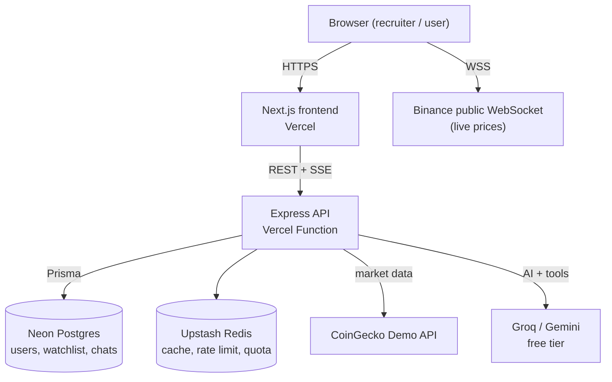

# TRIYUAI — Product Requirements Document

**Crypto Market Dashboard + AI Chatbot (Portfolio Project)**

| | |
| --- | --- |
| Version | 1.0 |
| Last updated | 2026-10-28 |
| Author | _Your name_ |
| Status | Approved for development |

---

## 1. Summary

TRIYUAI is an English-language crypto market dashboard inspired by CoinMarketCap and CoinGecko, built as a portfolio project for Frontend / Full Stack Web Developer roles. The goal is not to compete with CoinMarketCap but to demonstrate the skills recruiters look for: a fast, data-heavy UI, real-time updates, an AI chatbot with tool calling, automated testing, a backend API, and a public deployment.

| Item | Value |
| --- | --- |
| Type | Portfolio project (non-commercial) |
| Website language | English only |
| Currency | USD by default, switchable to IDR / EUR |
| Team | Solo developer |
| Build order | Frontend → Testing → Backend → Public launch |
| Key features | Real-time market table, interactive coin detail charts, AI chatbot "Ask TRIYU" |
| Timeline | ~16 weeks part-time (15–20 h/week) |
| Cost | $0 — Vercel Hobby, Neon Free, Upstash Free, CoinGecko Demo, Binance WebSocket, Groq / Gemini free tiers (custom domain optional, ~$10/year) |
| Deliverables | Public live URL, public GitHub repo, README + API docs, green CI |

Complex features that add little value for a recruiter (premium plans, payments, ads, admin panel, alerts, on-chain data) are intentionally out of scope.

---

## 2. Project goals: what recruiters should see

Every feature exists because it proves a specific skill that appears in Frontend / Full Stack job listings.

| Skill demonstrated | Evidence in TRIYUAI |
| --- | --- |
| Modern React & Next.js | App Router, Server Components, SSR/ISR for market and coin pages |
| TypeScript | Strict mode, zero errors, Zod schemas and types shared between frontend and backend |
| Data fetching & state | TanStack Query (caching, pagination, optimistic updates), Zustand |
| Data-heavy UI & performance | 250-coin table with sorting, filtering, sparklines; Lighthouse ≥ 90 |
| Real-time | Live prices via Binance public WebSocket with up/down flash animation |
| Data visualization | Interactive line/candlestick charts, sparklines, gauge |
| AI integration | Streaming chatbot with tool calling over real market data |
| UX polish | Dark mode, responsive layout, skeletons, error/empty states, ⌘K command palette, accessibility |
| Testing | Unit & component (Vitest + RTL), E2E (Playwright), API tests |
| Backend | Express REST API, PostgreSQL + Prisma, auth, caching, rate limiting, Swagger |
| DevOps | GitHub Actions CI, two Vercel projects (web + API), serverless database and cache, monitoring |
| Technical communication | README, architecture diagram, this PRD, clean commits and PRs |

---

## 3. Reference analysis

CoinMarketCap and CoinGecko offer hundreds of features. TRIYUAI keeps the ~10 core features that are most visible in a 2–3 minute demo, plus an AI chatbot as the differentiator.

| Feature on CMC / CoinGecko | TRIYUAI decision | Reason |
| --- | --- | --- |
| Coin ranking table (price, 1h/24h/7d %, market cap, volume, sparkline) | **Build** — top 250, sort, filter, pagination | Core of the product; proves table and performance skills |
| Global metrics bar | **Build** | Cheap to build, immediately visible |
| Coin detail page + chart | **Build** — main focus | Proves data viz and SSR |
| Trending, gainers & losers | **Build** | Available in the free API |
| Ask CMC AI / Ask Gecko | **Build** as "Ask TRIYU" | Signature feature; proves AI integration |
| Watchlist | **Build** — local first, then synced to account | Proves state management and full-stack auth |
| Converter | **Build** | Small and interactive |
| Fear & Greed Index | **Build (P1)** | Attractive gauge visual |
| Compare coins | **Build (P1)** | Bonus if time allows |
| Categories, exchange rankings, news | Optional (P2) | More pages, no new skills |
| Portfolio tracker | Optional (P2) | PnL logic is complex |
| Premium, ads, rewards, public API, community | **Drop** | Irrelevant for a portfolio |
| DEX / on-chain, derivatives, ETFs, RWA, NFT, prediction markets | **Drop** | Complex, requires paid data |
| Multi-language | **Drop** — English only | Focus on the job market |

---

## 4. Audience

The primary audience is recruiters and hiring managers who evaluate the project in 2–5 minutes; crypto investors are only the product scenario for the demo.

| Audience | What they do | What they must find |
| --- | --- | --- |
| Non-technical recruiter | Opens the live URL, clicks around for 1–2 minutes | A professional, fast, error-free UI; the AI chatbot is immediately visible |
| Hiring manager / engineer | Reads the README, repo structure, tests, PRs | Clear architecture, clean code, passing tests and CI, documented technical decisions |
| Demo user (crypto investor) | Checks prices and charts, asks the chatbot, saves a watchlist | Accurate data, easy to use on mobile and desktop |

**60-second demo script** (also used for the demo video and E2E tests):

1. Open the homepage → top coin prices flash live, global stats are visible.
2. Press ⌘K, search "solana" → open the coin detail page.
3. Switch the chart range from 7D to 1Y, toggle line/candlestick.
4. Click "Ask TRIYU about Solana" → the chatbot streams an answer using the latest price data.
5. Star the coin → it is added to the watchlist; log in with the demo account → the watchlist syncs.
6. Toggle dark mode and switch the currency to IDR.

---

## 5. Success criteria and non-goals

The project is done when it is publicly accessible and meets every quality bar below. These numbers will be quoted in the README and CV.

| Criterion | Target |
| --- | --- |
| Public deployment | Custom domain (or free `vercel.app` subdomain), HTTPS |
| Lighthouse mobile (home & coin detail) | Performance ≥ 90, Accessibility ≥ 95, Best Practices ≥ 95, SEO ≥ 95 |
| Core Web Vitals | LCP < 2.5 s, CLS < 0.1, INP < 200 ms |
| TypeScript | Strict mode, zero errors, no unjustified `any` |
| Test coverage | ≥ 80% for utils, hooks, components; ≥ 70% for backend services |
| E2E | 5 critical flows passing in CI (the demo script) |
| CI/CD | Every PR runs lint, type-check, tests, build; `main` auto-deploys |
| Documentation | Complete README, public Swagger, architecture diagram |
| Demo account | Available for recruiters (credentials in README) |
| Uptime | Monitoring active, ≥ 99% during the job search period |

**Non-goals** (intentionally not built):

- Premium features, subscriptions, payments.
- Ads of any kind.
- Admin panel, price alerts, email/push notifications.
- Multi-language support (English only).
- DEX/on-chain data, derivatives, NFT, RWA.
- In-house price aggregation across exchanges.
- Any paid API (data or AI).

---

## 6. Scope and phases

Work is split into four phases in this order. The API contract (Zod/OpenAPI schemas) is defined up front, so the Phase 1 frontend runs on a mock API (MSW) and only the base URL changes when the real backend is ready in Phase 3.

| Phase | Focus | Output |
| --- | --- | --- |
| 0. Setup & design | Monorepo, API contract, wireframes, basic CI | Repo ready, Vercel preview deployments working |
| 1. Frontend | All P0 pages on mock data + live Binance prices + chatbot UI (mock streaming) | Frontend live on Vercel (release `v0.1`) |
| 2. Testing | Unit/component, E2E, accessibility, Lighthouse CI | Green CI, coverage ≥ 80% (release `v0.2`) |
| 3. Backend | Express API, CoinGecko proxy + cache, Postgres, auth, watchlist sync, real AI chatbot, Swagger, API tests | Frontend connected to the real backend |
| 4. Deploy & launch | API on Vercel, Neon + Upstash in production, domain, monitoring, README, demo video | Full-stack public launch (release `v1.0`) |

**Feature priority**

| Feature | Priority | Phase |
| --- | --- | --- |
| Layout, navbar, footer, dark/light mode | P0 | 1 |
| Global stats bar | P0 | 1 |
| Market table top 250 + sparkline | P0 | 1 |
| Live prices (Binance WebSocket) | P0 | 1 |
| Coin detail + interactive chart | P0 | 1 |
| Command palette search (⌘K) | P0 | 1 |
| Highlights: trending, gainers, losers | P0 | 1 |
| Converter + USD/IDR/EUR currency switch | P0 | 1 |
| Watchlist | P0 | 1 (local) → 3 (account sync) |
| AI chatbot "Ask TRIYU" | P0 | 1 (UI + mock) → 3 (real AI) |
| Email/password auth + demo account | P0 | 3 |
| Fear & Greed gauge | P1 | 1 / 3 |
| Compare coins | P1 | 1 / 3 |
| Saved chat history per account | P1 | 3 |
| Google login | P1 | 3 |
| Categories, exchanges, news, portfolio tracker | P2 | After v1.0, if time allows |

---

## 7. Functional requirements

Each requirement has an ID (FR-xx), a priority, and acceptance criteria (AC) that map directly to test cases.

### M1 — Layout & global

- **FR-01 (P0)** Navbar: logo, menu (Markets, Highlights, Converter, Watchlist), search button, currency switch, theme toggle, "Ask TRIYU" button, Login/Avatar.
- **FR-02 (P0)** Global stats bar: total market cap + 24h %, 24h volume, BTC dominance, ETH dominance, active coins.
  - AC: auto-refresh every 60 s (React Query `refetchInterval`); color + ▲▼ icon for up/down.
- **FR-03 (P0)** Command palette (⌘K / Ctrl+K): search coins by name/symbol, show trending when empty, recent searches.
  - AC: 250 ms debounce; fully keyboard navigable (↑ ↓ Enter Esc).
- **FR-04 (P0)** Theme (dark/light/system) and currency (USD/IDR/EUR) persisted in localStorage; all numbers formatted with `Intl.NumberFormat` (compact notation for large values, e.g. $1.62T).
- **FR-05 (P0)** Footer: "Data provided by CoinGecko" (required), "Not financial advice" disclaimer, GitHub link, "Built by [name]".
- **FR-06 (P0)** Custom 404, global error boundary, `/about` page ("How I built this" case study).

### M2 — Homepage & market table

- **FR-07 (P0)** Highlight cards above the table: Trending (3), Top Gainers (3), Top Losers (3), "Ask TRIYU" promo card.
- **FR-08 (P0)** Table columns: #, coin (logo, name, symbol), price, 1h %, 24h %, 7d %, 24h volume, market cap, 7-day sparkline, star button.
  - AC: 100 rows per page, 3 pages (top 250), page number in the URL (`?page=2`); sortable columns; text filter; sticky header; on mobile the coin column is sticky and the table scrolls horizontally.
- **FR-09 (P0)** Live prices: the top 20 coins with a USDT pair subscribe to the Binance public WebSocket (mini ticker stream); price cells flash green/red on change; "Live" indicator.
  - AC: automatic reconnect with exponential backoff; if the WebSocket fails, silently fall back to polling.
- **FR-10 (P0)** Loading skeletons, error state with "Retry", empty state when the filter matches nothing.

### M3 — Coin detail (`/coins/[id]`)

- **FR-11 (P0)** Header: logo, name, symbol, rank, price, 24h %, 24h low–high bar, star button, share (copy link).
- **FR-12 (P0)** Chart: line/candlestick toggle, ranges 24H/7D/1M/3M/1Y/MAX, crosshair + tooltip, responsive.
  - AC: switching range shows a skeleton; previously loaded ranges come from cache.
- **FR-13 (P0)** Stats grid: market cap, FDV, 24h volume, circulating/total/max supply (+ progress bar), ATH & ATL with dates and % from ATH.
- **FR-14 (P0)** Mini converter (coin ↔ fiat).
- **FR-15 (P0)** About: description (sanitized HTML), website/whitepaper/explorer/social links, category tags.
- **FR-16 (P0)** "Ask TRIYU about [Coin]" button opens the chatbot with a contextual question.
- **FR-17 (P0)** SEO: dynamic metadata and auto-generated OG image (`next/og`) with coin name and price.

### M4 — AI chatbot "Ask TRIYU"

- **FR-18 (P0)** Floating chat button on every page → panel (drawer on desktop, full-screen sheet on mobile) + dedicated `/ask` page.
- **FR-19 (P0)** Token-by-token streaming, markdown rendering (tables, lists), Stop, Copy, Regenerate.
- **FR-20 (P0)** Suggested prompts: "What's moving the market today?", "Compare BTC and ETH", "Explain market cap vs FDV"; coin-specific prompts on coin pages.
- **FR-21 (P0)** Backend tool calling: `getMarketOverview`, `getCoinDetails(id)`, `getTopMovers`, `searchCoin(query)`, `compareCoins(ids)` → answers grounded in real data; the UI shows a "Fetched: Bitcoin price" chip while a tool runs.
  - AC: numbers in the answer match the API data at the same moment; the answer states the data timestamp.
- **FR-22 (P0)** Guardrails: refuses buy/sell advice, always shows a disclaimer; quota of 10 messages/day for guests and 30/day for logged-in users (protects the free LLM tier); friendly message when the quota is reached or the LLM is rate-limited.
- **FR-23 (P0)** Conversation context of the last 10 messages within a session.
- **FR-24 (P1)** Conversation history saved per account.
- **FR-25 (P0, Phase 1)** Mock mode: until the backend exists, MSW returns fake streaming answers so the chat UI can be built and tested first.

### M5 — Highlights & tools

- **FR-26 (P0)** `/highlights`: Trending, Top Gainers, Top Losers (within the top 250), highest volume.
- **FR-27 (P0)** `/converter`: coin ↔ fiat/coin, swap button, state synced to the URL (`?from=bitcoin&to=usd&amount=1`).
- **FR-28 (P1)** `/compare?coins=bitcoin,ethereum`: side-by-side stats + normalized performance chart (%).
- **FR-29 (P1)** Fear & Greed gauge + 30-day history.

### M6 — Account & watchlist

- **FR-30 (P0, Phase 1)** Local watchlist (Zustand + localStorage persistence); `/watchlist` reuses the market table component.
- **FR-31 (P0, Phase 3)** Auth: register (email, password with strength rules), login, logout, `me`; 15-minute access token + 7-day refresh token in `httpOnly` cookies with rotation.
- **FR-32 (P0, Phase 3)** On first login, the local watchlist is merged into the account (no duplicates); add/remove uses optimistic updates with rollback on failure.
- **FR-33 (P0, Phase 3)** "Try demo account" button for recruiters (seeded demo user, reset daily).
- **FR-34 (P1)** Google login.

---

## 8. Sitemap and user flow

Eleven pages are enough to showcase the different rendering strategies (SSR, ISR, SSG, client-side) commonly discussed in Next.js interviews.

| Page | URL | Rendering | Phase |
| --- | --- | --- | --- |
| Homepage / market table | `/`, `/?page=2` | SSR + ISR 60 s, then client refetch | 1 |
| Coin detail | `/coins/bitcoin` | ISR 60 s, `generateStaticParams` for top 100 | 1 |
| Highlights | `/highlights` | ISR 60 s | 1 |
| Converter | `/converter` | Client | 1 |
| Compare (P1) | `/compare?coins=bitcoin,ethereum` | Client | 1 / 3 |
| Watchlist | `/watchlist` | Client | 1 → 3 |
| Ask TRIYU | `/ask` (+ panel on every page) | Client | 1 → 3 |
| Login / Register | `/login`, `/register` | Client | 3 |
| About / case study | `/about` | SSG | 4 |
| Disclaimer | `/disclaimer` | SSG | 1 |
| 404 | — | SSG | 1 |

**Main flow — guest to user**

1. A guest stars 3 coins → saved in localStorage.
2. The guest asks Ask TRIYU questions until the guest quota runs out → login prompt appears.
3. Login (or "Try demo account") → local watchlist merges into the account, chatbot quota increases.
4. Opening the site on another device shows the same watchlist.

---

## 9. Non-functional requirements

Technical quality is the "feature" engineers judge most when reviewing a portfolio, so targets are measurable and checked automatically in CI.

| Category | Target |
| --- | --- |
| Performance | Lighthouse ≥ 90 (mobile); initial JS per page < 200 KB gzip; images via `next/image` |
| Data freshness | Top 20 live (WebSocket); other data ≤ 5 minutes (free tier limit) with an "Updated x min ago" label |
| Accessibility | WCAG 2.2 AA: keyboard navigation, visible focus, ARIA labels, sufficient contrast, up/down not conveyed by color alone |
| Responsive | 360 px to 1920 px; tested in Chrome, Safari, Firefox |
| Resilience | When the data API or AI is rate-limited, show the last snapshot or a friendly message, never an error page |
| Security | See Section 15 |
| Code quality | ESLint + Prettier, strict TypeScript, conventional commits, one PR per feature |
| Observability | Sentry for frontend and backend errors, free uptime monitor |

---

## 10. Architecture and tech stack

A TypeScript monorepo with two Vercel projects: `apps/web` (Next.js) and `apps/api` (Express, running as a single Vercel Function). The browser gets live prices directly from Binance; all CoinGecko and LLM calls go through the API so keys stay secret. Account data lives in Neon Postgres; cache and rate limiting live in Upstash Redis.



Vercel Functions do not keep memory between requests, so cache and quota counters must live in Upstash Redis rather than in server memory. In Phase 1 the API box is replaced by MSW in the browser, using the same contract.

**Free hosting, database, and cache**

| Service | Used for | Free tier | Notes |
| --- | --- | --- | --- |
| Vercel Hobby | Hosting web + API (2 projects) | Free for personal, non-commercial projects; Express deploys with zero config as a single Vercel Function; max function duration 300 s | Enough for chatbot streaming |
| Neon Free | PostgreSQL | 0.5 GB storage and 100 CU-hours per project/month, scale-to-zero after 5 minutes idle, no credit card | Wakes automatically in a few hundred ms |
| Upstash Redis Free | CoinGecko cache, rate limiting, AI quota | 256 MB data, 500K commands/month, 10 GB bandwidth/month, 1 database | ~4 commands per request ≈ 125K API requests/month |
| Supabase Free *(not chosen)* | — | 500 MB database, 2 projects | Projects pause after 1 week of inactivity — risky when a recruiter opens the link later |

**Tech stack**

| Layer | Choice | Portfolio value |
| --- | --- | --- |
| Monorepo | pnpm workspaces + Turborepo: `apps/web`, `apps/api`, `packages/shared` (Zod schemas & types) | Real-world project structure |
| Frontend framework | Next.js 15 (App Router), React 19, strict TypeScript | Most requested frontend stack |
| Styling & UI | Tailwind CSS v4, shadcn/ui (Radix), lucide-react, Framer Motion | Clean, accessible UI |
| Data fetching | TanStack Query | Caching, refetching, pagination, optimistic updates |
| Client state | Zustand | Local watchlist, preferences, chat panel |
| Tables | TanStack Table | Sorting, filtering, custom columns |
| Charts | TradingView Lightweight Charts + custom SVG sparkline | Free, trading-grade |
| Forms | React Hook Form + Zod | Validation shared with the backend |
| Chat UI | Vercel AI SDK (`useChat`) + react-markdown | Streaming and tool UI |
| Mock API | MSW | Frontend works before the backend exists |
| Frontend tests | Vitest, React Testing Library, Playwright, axe-core, Lighthouse CI | Proof of quality |
| Backend | Node.js 22, Express 5, TypeScript, Zod, Pino — deployed to Vercel | Simple, universally recognized |
| Database | Neon Postgres + Prisma ORM | Clean migrations and seeding |
| Cache & rate limit | Upstash Redis + `@upstash/ratelimit` | Correct serverless patterns |
| Auth | JWT access + refresh tokens in `httpOnly` cookies, argon2 password hashing | Common interview topic |
| AI backend | Vercel AI SDK Core + Groq free tier (`openai/gpt-oss-120b`), Gemini free tier as fallback | Free, supports tool calling, swappable provider |
| API docs | OpenAPI generated from Zod schemas + Swagger UI at `/docs` | Recruiters can try the API |
| Backend tests | Vitest + Supertest + Testcontainers (local Postgres in Docker) | Real integration tests |
| CI/CD | GitHub Actions (lint, test, build) + Vercel (auto deploy, preview per PR) | Industry workflow |
| Monitoring | Sentry (free), UptimeRobot / Better Stack (free), Vercel Analytics | Errors and uptime tracked |

---

## 11. Data sources and AI (all free)

All coin ticker data and AI use free tiers with no credit card: CoinGecko Demo API for market data, the Binance public WebSocket for live prices, and Groq's free tier for the chatbot with Gemini's free tier as a fallback.

| Need | Free service | Free limits | Called from |
| --- | --- | --- | --- |
| Coin list, global stats, trending, details, charts, search, exchange rates | CoinGecko Demo API | 10,000 calls/month, 100/min, data refreshed from 60 s, attribution "Data provided by CoinGecko" required | Backend (Phase 3); JSON fixtures + MSW (Phase 1) |
| Live prices for top 20 | Binance public WebSocket (mini ticker stream) | No API key | Directly from the browser |
| Fear & Greed (P1) | Alternative.me public API | No API key | Backend, cached 1 hour |
| AI chatbot (primary) | Groq free tier, model `openai/gpt-oss-120b` | Sample limits: 30 requests/min, 1,000 requests/day, 8,000 tokens/min, 200,000 tokens/day (per organization; exact values in the Groq console) | Backend only |
| AI chatbot (fallback) | Gemini API free tier via Google AI Studio | Per-model limits shown in AI Studio; low RPM on the free tier | Backend only |

At ~2,000–3,000 tokens per conversation (including tool data), Groq's 200,000 tokens/day covers roughly 60–100 conversations per day — plenty for portfolio traffic. Per-user quotas (10 guest messages, 30 logged-in messages) are still enforced.

**Staying within the 10,000 CoinGecko calls/month**

| Data | Endpoint | Cache TTL | Max calls/day under non-stop traffic |
| --- | --- | --- | --- |
| Top 250 coins (USD only) | `/coins/markets` | 5 min | 288 |
| Global stats | `/global` | 10 min | 144 |
| Trending | `/search/trending` | 15 min | 96 |
| USD → IDR/EUR rates | `/exchange_rates` | 1 hour | 24 |
| Coin detail | `/coins/{id}` | 10 min per coin | Per visit |
| Chart | `/coins/{id}/market_chart` | 5 min – 6 hours by range | Per visit |

The worst case (visited non-stop for 24 hours) is 552 calls/day ≈ 16,500/month, which exceeds the quota. Strategy to stay free:

1. On-demand caching: the API is only called when someone visits and the cache has expired. Portfolio traffic (dozens of visits/day) is estimated at under 3,000 calls/month.
2. Fetch prices in USD only; convert to IDR/EUR using exchange rates cached for 1 hour.
3. A usage counter is stored in Upstash Redis; above 8,000 calls in the current month, TTLs are automatically tripled.
4. On a rate limit (HTTP 429), the backend serves the last snapshot from the database with a "Data delayed" badge.
5. The top 20 coins still feel real-time because their prices come from the Binance WebSocket, not CoinGecko.

---

## 12. Data model

The database is intentionally small: market data is not stored per coin (CoinGecko remains the source of truth). Neon Postgres stores accounts, watchlists, chats, and fallback snapshots; short-lived, frequently changing data (cache, quotas, rate limits) lives in Upstash Redis.

**PostgreSQL (Neon, Prisma models)**

| Model | Key fields | Notes |
| --- | --- | --- |
| `User` | id, email (unique), passwordHash, name, isDemo, createdAt | Demo user seeded and reset daily |
| `RefreshToken` | id, userId, tokenHash, expiresAt, revokedAt | Refresh token rotation |
| `WatchlistItem` | id, userId, coinId (CoinGecko id), createdAt; unique(userId, coinId) | |
| `ChatConversation` (P1) | id, userId, title, createdAt | Chat history per account |
| `ChatMessage` (P1) | id, conversationId, role, content, toolCalls (JSON), createdAt | |
| `MarketSnapshot` | key (e.g. `markets:usd`), payload (JSONB), fetchedAt | Fallback when CoinGecko is rate-limited |

**Redis (Upstash)**

| Key | Content | TTL |
| --- | --- | --- |
| `cg:markets:usd`, `cg:global`, `cg:trending`, `cg:coin:{id}`, `cg:chart:{id}:{range}` | CoinGecko responses | Per the cache table above |
| `usage:coingecko:{yyyy-mm}` | CoinGecko calls this month | 35 days |
| `ai:quota:{userId or ipHash}:{yyyy-mm-dd}` | Chatbot messages today | 24 hours |
| `ratelimit:*` | Managed by `@upstash/ratelimit` | Automatic |

---

## 13. API design

JSON REST under `/api/v1` plus SSE for chatbot streaming. The contract is written once as Zod schemas in `packages/shared`, used by MSW in Phase 1, by backend validation in Phase 3, and to generate Swagger at `/docs`.

| Method | Path | Auth | Purpose |
| --- | --- | --- | --- |
| GET | `/api/v1/global` | — | Global stats |
| GET | `/api/v1/coins?page=1&perPage=100&currency=usd` | — | Market table |
| GET | `/api/v1/coins/:id` | — | Coin detail |
| GET | `/api/v1/coins/:id/chart?range=7d&type=ohlc` | — | Chart data |
| GET | `/api/v1/highlights` | — | Trending, gainers, losers |
| GET | `/api/v1/search?q=sol` | — | ⌘K search |
| GET | `/api/v1/rates` | — | USD → IDR/EUR rates |
| GET | `/api/v1/fear-greed` (P1) | — | Index + 30-day history |
| POST | `/api/v1/auth/register`, `/login`, `/logout`, `/refresh` | — | Authentication |
| POST | `/api/v1/auth/demo` | — | Demo account login |
| GET | `/api/v1/auth/me` | User | Profile |
| GET / POST / DELETE | `/api/v1/watchlist`, `/api/v1/watchlist/:coinId` | User | Watchlist |
| POST | `/api/v1/watchlist/merge` | User | Merge local watchlist on login |
| POST | `/api/v1/ai/chat` → `text/event-stream` | Optional | Streaming chatbot (guest or user) |
| GET | `/api/v1/health` | — | Health check for uptime monitoring (does not touch the database) |
| GET | `/docs` | — | Swagger UI |

**Chatbot request example**

```http
POST /api/v1/ai/chat
Content-Type: application/json

{
  "messages": [{ "role": "user", "content": "Why is SOL down today?" }],
  "context": { "coinId": "solana" }
}
```

Stream: `tool-call getCoinDetails("solana")` → `tool-result` → text tokens… → `finish`.

**General rules**

- Success shape `{ data, meta: { fetchedAt, source, stale } }`; error shape `{ error: { code, message } }`.
- Rate limit: 120 requests/min per IP; chatbot limited by daily quota.
- CORS restricted to the frontend domain; cookies `SameSite=Lax`, `Secure`.
- All input validated with Zod; responses validated in contract tests.

---

## 14. UI/UX and design system

Visual direction: a clean, modern data dashboard. Dark mode is the hero look for screenshots and the demo video.

**Design principles**

1. **5-second first impression** — the homepage immediately shows moving live prices and the Ask TRIYU button.
2. **Data first** — price and % change are the largest, highest-contrast elements.
3. **AI is unmistakable** — AI components use a dedicated accent color and sparkle icon.
4. **Mobile-first** — on mobile the table shows coin, price, 24h %, then scrolls horizontally.
5. **Consistent up/down** — green ▲ / red ▼ everywhere.

**Initial design tokens**

| Token | Light | Dark | Usage |
| --- | --- | --- | --- |
| `--bg` | #FFFFFF | #0B0E14 | Page background |
| `--surface` | #F6F7F9 | #121722 | Cards, table header |
| `--text` | #0F172A | #E6EAF2 | Primary text |
| `--muted` | #64748B | #8A94A6 | Secondary labels |
| `--brand` | #5B5BF7 | #7C7CFF | Primary buttons, links, logo |
| `--ai` | #8B5CF6 → #06B6D4 (gradient) | same | AI elements only |
| `--up` | #16A34A | #22C55E | Price up |
| `--down` | #DC2626 | #EF4444 | Price down |

Typography: Inter for UI, tabular numerals (`font-variant-numeric: tabular-nums`) in price columns so digits do not shift on update. Scale 12/14/16/20/24/32 px, 4 px spacing grid.

**Core components**: GlobalStatsBar, Navbar, CommandPalette, MarketTable, PriceCell (flash animation), PercentBadge, Sparkline, PriceChart, StatsGrid, Converter, ChatPanel, ChatMessage (markdown + tool chip), WatchlistButton, Skeleton, ErrorState, EmptyState.

Design deliverable: simple wireframes (Figma or paper) for the 5 main pages in weeks 1–2; the final UI is built directly in code with customized shadcn/ui.

---

## 15. Security and basic legal

Standard security practices that commonly come up in interviews; no payments or sensitive data beyond email and password.

- CoinGecko, Groq, and Gemini keys live only in backend environment variables, never in the frontend bundle; `.env.example` contains no real values.
- Passwords hashed with argon2; tokens in `httpOnly` + `Secure` + `SameSite=Lax` cookies; refresh tokens rotated and revocable.
- All input validated with Zod; Prisma prevents SQL injection; coin descriptions (HTML from the API) are sanitized before rendering.
- `helmet` for security headers, CORS allowlist, per-IP rate limiting with `@upstash/ratelimit`.
- Chatbot: system prompt forbids buy/sell advice, tool output is treated as data rather than instructions, input/output length limits, daily quota.
- The demo account cannot change its email/password and is reset daily.
- Dependabot + `pnpm audit` in CI.
- Light legal: "Not financial advice" disclaimer page, "Data provided by CoinGecko" attribution per the Demo API terms, short privacy policy (only email and watchlist are stored).

---

## 16. Portfolio presentation

There are no ads or monetization; the "product" being sold is you as a developer. The repo and live demo must be understandable to a recruiter in 2 minutes.

**README checklist**

- [ ] Banner + one-line value proposition ("Real-time crypto dashboard with an AI market assistant").
- [ ] Buttons: Live Demo, Swagger Docs, Demo Video (60–90 s).
- [ ] GIFs/screenshots: live homepage, coin detail, chatbot streaming, mobile view, dark mode.
- [ ] Demo account credentials.
- [ ] Tech stack badges, architecture diagram, folder structure.
- [ ] "Engineering decisions": why MSW first, why on-demand caching, why Groq, trade-offs made.
- [ ] Quality results: Lighthouse scores, coverage, CI badge.
- [ ] Local setup (`pnpm i`, `.env.example`, `docker compose up` for local Postgres).
- [ ] Roadmap and known limitations (free-tier limits, data delay).

**Repo habits engineers notice**

- Conventional commits, one PR per feature with description + screenshots, GitHub Projects board.
- Tagged releases: `v0.1` frontend, `v0.2` testing, `v1.0` full stack live.
- `docs/` folder with this PRD, diagrams, and short architecture decision records (ADRs).

**`/about` page on the site**: a short case study — problem, features, architecture, challenges (rate limits, real-time, AI streaming), and lessons learned.

**Basic SEO**: per-page metadata, sitemap for the top 100 coins, dynamic OG images, `robots.txt`.

**Sample CV bullets** (fill in numbers once achieved):

- Built TRIYUAI, a real-time crypto market dashboard (Next.js 15, TypeScript, TanStack Query) with live WebSocket price updates and a Lighthouse performance score of [xx].
- Integrated an AI market assistant using LLM tool calling and streaming (SSE), grounding answers in live market data.
- Designed a REST API (Express, PostgreSQL, Prisma) with JWT auth, Redis caching that keeps usage within free API quotas, and Swagger docs; deployed on Vercel with GitHub Actions CI.
- Achieved [xx]% test coverage with Vitest, React Testing Library, and Playwright E2E tests.

---

## 17. Project plan (solo)

Built solo over ~16 weeks at 15–20 hours/week. The frontend is live on Vercel by week 8, so the portfolio link can be used in applications before the backend is finished.

| Phase | Weeks | Release |
| --- | --- | --- |
| Setup & design | 1–2 | — |
| Frontend (mock API) | 3–8 | `v0.1` frontend live (week 8) |
| Frontend testing | 9–10 | `v0.2` green CI (week 10) |
| Backend API & auth | 11–12 | — |
| AI chatbot backend | 13 | — |
| Backend testing | 14 | — |
| Deploy & documentation | 15–16 | `v1.0` public full-stack launch (week 16) |

**Week-by-week**

1. **Weeks 1–2 · Setup & design** — pnpm + Turborepo monorepo, ESLint/Prettier/Husky, Next.js + Tailwind + shadcn/ui, Zod schemas in `packages/shared`, CoinGecko JSON fixtures, MSW setup, wireframes for 5 pages, basic CI, Vercel preview deployments.
2. **Week 3** — layout, navbar, footer, theme, currency switch, global stats bar.
3. **Week 4** — market table: columns, sparklines, sorting, filtering, pagination, skeletons.
4. **Week 5** — live prices via Binance WebSocket, highlight cards, `/highlights`, ⌘K command palette.
5. **Week 6** — coin detail: header, chart (ranges + line/candle), stats grid, about, mini converter.
6. **Week 7** — chatbot UI: floating panel, `/ask`, mock streaming, markdown, tool chips, suggested prompts.
7. **Week 8** — local watchlist, `/converter`, responsive & accessibility polish, 404/error states → **release v0.1 (frontend live)**.
8. **Weeks 9–10 · Testing** — unit (formatters, hooks, stores), component (table sorting, PriceCell, ChatPanel), Playwright for the 5 demo flows, axe, Lighthouse CI, full GitHub Actions pipeline → **release v0.2**.
9. **Week 11** — Express + Prisma + Postgres (local Docker), CoinGecko service + Redis cache + snapshot + usage counter, market endpoints, Swagger.
10. **Week 12** — auth (register, login, refresh, demo), watchlist + merge; frontend switches from MSW to the real API.
11. **Week 13** — AI endpoint: Vercel AI SDK + Groq, 5 tools, SSE, daily quota, Gemini fallback.
12. **Week 14** — backend tests (Supertest + Testcontainers), contract tests, E2E against the real backend.
13. **Weeks 15–16 · Deploy & launch** — deploy the API as a second Vercel project, connect Neon + Upstash in production via the Vercel Marketplace, domain, Sentry, uptime monitoring, README, `/about`, demo video, LinkedIn post → **release v1.0 (public launch)**.

**Cost**

| Item | Choice | Cost |
| --- | --- | --- |
| Web + API hosting | Vercel Hobby (2 projects) | $0 |
| Database | Neon Free | $0 |
| Cache & rate limiting | Upstash Redis Free | $0 |
| Market data | CoinGecko Demo API + Binance WebSocket | $0 |
| AI | Groq free tier + Gemini free tier | $0 |
| CI & monitoring | GitHub Actions (public repo), Sentry free, UptimeRobot free | $0 |
| Domain | Optional (free `vercel.app` subdomain works) | ~$10/year |

---

## 18. Risks and mitigations

The biggest risk for a solo project is not finishing because scope keeps growing; the rest are free-tier limits.

| Risk | Mitigation |
| --- | --- |
| Scope creep (trying to copy every CMC feature) | Lock P0 scope in this document; P1/P2 only after the current release ships |
| Project looks like a "tutorial clone" | Highlight the tool-calling AI chatbot, live prices, testing, and a README with technical decisions |
| CoinGecko free quota runs out | On-demand caching, in-house currency conversion, adaptive TTL, fallback snapshots |
| Groq / Gemini free-tier limits | Per-user message quotas, Groq → Gemini fallback, friendly "AI is busy, try again in a minute" message |
| Chatbot abuse (spam, prompt injection) | Per-IP rate limiting, message length limits, system-prompt guardrails |
| Binance WebSocket unavailable on some networks | Fall back to polling backend data; UI keeps working |
| Running out of time/energy | The week-8 frontend release is already usable for applications; the backend follows |
| Cold starts (Vercel Function / Neon waking up) when a recruiter opens the link | Market data served from Upstash cache without touching the database; Neon wakes in a few hundred ms; uptime monitor pings a health endpoint that does not touch the database (to preserve Neon compute hours) |

---

## 19. Open questions

Decide these before week 1; otherwise use the default on the right.

| Question | Proposed default |
| --- | --- |
| Primary target role: Frontend or Full Stack? | Full Stack, with the CV emphasizing frontend until v1.0 ships |
| Realistic hours per week? | 15–20 h (16-week timeline); 10 h → ~24 weeks |
| Separate Express project or Next.js Route Handlers for the backend? | Separate Express project on Vercel (clearer proof of backend skills) |
| Custom domain? | Yes if possible (more professional), ~$10/year |
| Express or NestJS? | Express (simpler); NestJS if target listings ask for it |
| Google login? | Not for v1.0 (P1) |
| Name shown in footer and `/about`? | Full name + LinkedIn and GitHub links |

---

## 20. References

Pages consulted on 2026-10-28:

- [CoinMarketCap](https://coinmarketcap.com/)
- [CoinGecko](https://www.coingecko.com/)
- [CoinGecko API — plans & pricing (including free Demo)](https://www.coingecko.com/en/api/pricing)
- [Gemini API — rate limits](https://ai.google.dev/gemini-api/docs/rate-limits)
- [Groq API free tier — limits summary](https://benchlm.ai/free-tier/groq)
- [Groq API free tier — verified limits](https://www.developersdigest.tech/models/free-api/groq)
- [Express on Vercel](https://vercel.com/docs/frameworks/backend/express)
- [Vercel Functions — duration limits with Fluid compute](https://vercel.com/changelog/higher-defaults-and-limits-for-vercel-functions-running-fluid-compute)
- [Neon — Free plan](https://neon.com/faqs/managed-postgres-databases-free-tier)
- [Upstash Redis — pricing & free tier](https://upstash.com/docs/redis/overall/pricing)
- [Supabase — pricing](https://supabase.com/pricing)
