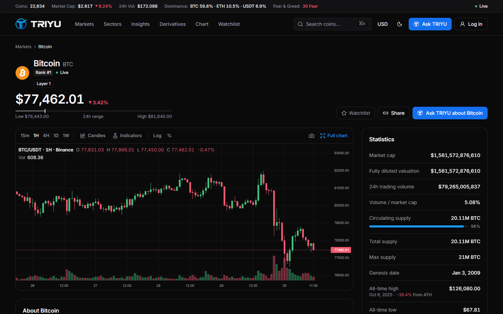
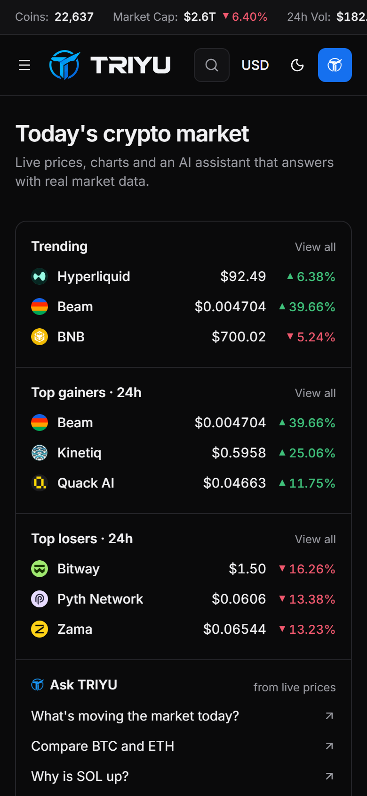
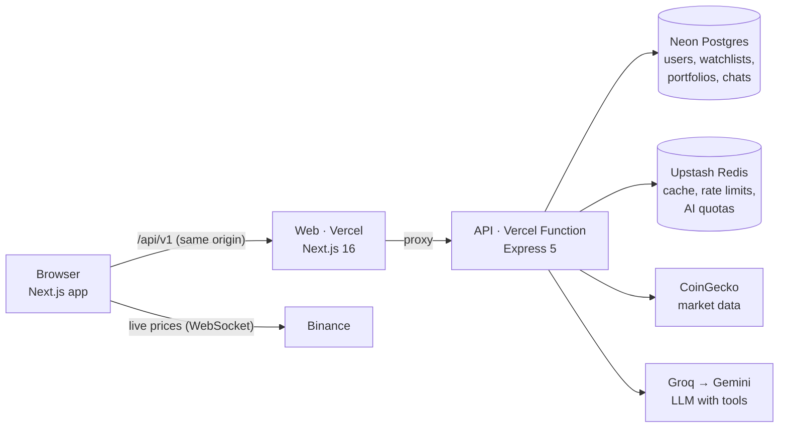

# TRIYUAI

[](https://github.com/Rtmagent7/triyuai/actions/workflows/ci.yml) [](https://github.com/Rtmagent7/triyuai/releases/latest) [](https://github.com/Rtmagent7/triyuai/actions/workflows/uptime.yml)

A real-time crypto market dashboard with an AI assistant that answers from live data.

**[Open the live site](https://triyuai.vercel.app)** · **[Watch the 1:46 demo](https://github.com/Rtmagent7/triyuai/releases/download/v1.0.0/triyu-demo.mp4)** · **[API docs](https://triyuai-api.vercel.app/docs)**


## In short

TRIYUAI tracks the top 250 cryptocurrencies, with prices that update live as trades happen. You can ask
"Ask TRIYU", its built-in assistant, questions like _"How is Solana doing this week compared to Ethereum?"_.
It looks the numbers up in the same market data the site shows, then answers. It doesn't guess
prices from memory, and it won't tell you what to buy.

I built it solo, end to end: product spec, UI, REST API, database, AI integration, tests, CI/CD and
deployment. It runs entirely on free tiers, so a large part of the work was keeping it fast and within
those limits.

## Try it in two minutes

1. Open **[triyuai.vercel.app](https://triyuai.vercel.app)**. The top 20 prices flash green or red as trades come in.
2. Press <kbd>Ctrl</kbd>+<kbd>K</kbd> (<kbd>⌘</kbd>+<kbd>K</kbd> on a Mac), type `solana` and open the coin page. Switch the chart between ranges and between line and candles.
3. Click **Ask TRIYU about Solana**. The answer streams in, and chips show which data it fetched.
4. Go to **[/login](https://triyuai.vercel.app/login)** and click **Try the demo account** (no sign-up). Star a few coins and record a trade in **Portfolio**; both are saved to the account.
5. Toggle dark/light mode and switch the currency to IDR or EUR from the navbar.

## What's inside

**Product**

- Market table for the top 250 coins: sorting, filtering, sparklines and pagination. The header and coin column stay pinned on phones.
- Coin pages with a price chart (24 hours to max, line or candlestick), key stats, a converter and an auto-generated preview image for link sharing.
- A full technical-analysis chart: Binance candles from 1 minute to 1 month, configurable indicators, 27 drawing tools and saved layouts.
- Watchlist and portfolio tracker. The portfolio shows average cost, realised and unrealised profit and allocation, at live prices.
- Market context: Fear & Greed Index, dominance, sector performance, coin comparison, exchange rankings, news tagged by coin, and a derivatives page (liquidation heatmap, funding rates, open interest).
- Accounts with email and password, Google sign-in, and a one-click demo account. A guest's watchlist moves into the account at first sign-in.

**Ask TRIYU, the AI assistant**

- The model reads data only through eight tools (market overview, coin details, top movers, search, compare, sentiment, sectors, news), all backed by the same cached data as the site.
- Answers stream token by token over Server-Sent Events, with Stop, Copy and Regenerate.
- Groq runs first and Gemini takes over if it fails. Signed-in users get their conversations saved, and daily quotas keep it within the free tiers.

**Engineering**

- A typed API contract (Zod) shared by the frontend, the backend, the mock server and the Swagger docs.
- CoinGecko's free plan allows 10,000 calls a month. Redis caching and request de-duplication keep the site inside that at any traffic level. When the provider is down, the last good data is served with a "Data delayed" badge instead of an error.
- Secure sessions: argon2id password hashing, short-lived JWT cookies, and refresh tokens that rotate and detect reuse.
- 441 automated tests across unit, component, API, end-to-end and accessibility, all run on every pull request.

## Screenshots

| Ask TRIYU answering from live data             | Technical-analysis chart                         |
| ---------------------------------------------- | ------------------------------------------------ |
|          |              |
| **Insights: Fear & Greed, dominance, sectors** | **Derivatives: liquidation heatmap, funding**    |
|      |  |
| **Coin page**                                  | **On a phone**                                   |
|         |            |

## How it fits together



The browser only talks to its own domain. Next.js forwards `/api/v1` to the API, so login cookies
stay first-party and no CORS setup is needed. Live prices come straight from Binance's public
WebSocket, and everything else goes through the API, which caches it.

| Layer    | Tools                                                                                             |
| -------- | ------------------------------------------------------------------------------------------------- |
| Frontend | Next.js 16 (App Router), React 19, TypeScript, Tailwind CSS v4, TanStack Query and Table, Zustand |
| Backend  | Node 22, Express 5, Prisma 7, PostgreSQL (Neon), Redis (Upstash), Zod, OpenAPI/Swagger            |
| AI       | Vercel AI SDK, Groq, Google Gemini, tool calling, SSE streaming                                   |
| Quality  | Vitest, React Testing Library, MSW, Supertest, Playwright, axe-core, Lighthouse CI                |
| Ops      | Vercel (two projects), GitHub Actions, Sentry, scheduled uptime checks, Dependabot                |
| Monorepo | pnpm workspaces, Turborepo                                                                        |

## Decisions worth a look

Each of these has a short write-up in [`docs/adr`](docs/adr/README.md).

- **Frontend first, on a mock API.** The API contract came first, and the frontend shipped on a mock server built from it. That got a usable site live before the backend existed. Switching to the real API took two environment variables.
- **Staying inside a 10,000-call budget.** Each endpoint has its own cache lifetime, concurrent requests share one upstream call, and cache times triple once 80% of the month is used.
- **An AI that can't make up prices.** Every number in an answer comes from a tool call. If the main model fails before it starts answering, the backup model takes over without the user noticing.
- **The whole API as one serverless function.** esbuild bundles it into a single file. Production builds apply database migrations, and only `main` deploys.
- **Google sign-in without an auth library.** It uses the standard authorization code flow with PKCE, and the token is verified against Google's public keys. It's about 150 lines, with tests against a fake Google.
- **Monitoring that costs nothing when idle.** Sentry loads in the browser only after the page has finished loading. Only unexpected errors are reported, never cookies or request bodies.

## Quality

| Check                        | Result                                                                    |
| ---------------------------- | ------------------------------------------------------------------------- |
| Web unit and component tests | 278 tests, ~93% line coverage (gate: 80%)                                 |
| API tests                    | 88 tests, ~94% line coverage, every response checked against the contract |
| End-to-end                   | 75 Playwright tests covering the main user flows                          |
| Accessibility                | axe-core on 8 pages in dark and light mode (WCAG 2.2 AA), keyboard flows  |
| Lighthouse (mobile, CI)      | Home: 91 performance, 100 accessibility, 100 best practices, 100 SEO      |
|                              | Coin page: 90 / 100 / 96 / 100                                            |

CI runs four jobs in parallel on every pull request: lint, types and unit tests; API tests against
real Postgres; end-to-end and accessibility; and Lighthouse. A scheduled workflow checks the live site
every 15 minutes and opens an issue if it stays down.

Some bugs the tests caught before users did:

- Light-mode text didn't meet WCAG contrast, so the colour tokens were darkened.
- Number formatting differed between Node and browsers, which broke hydration.
- Homepage links prefetched every visible coin page, burning dozens of API calls per visit.
- Starring a coin before the session had loaded saved it to the device instead of the account.

## Run it locally

You need Node 22+ and pnpm 10+. No database, Redis or API keys are required.

```bash
pnpm install
cp apps/web/.env.example apps/web/.env.local
pnpm --filter @triyuai/web dev        # http://localhost:3000, runs on the mock API
```

To run the real API as well:

```bash
cp apps/api/.env.example apps/api/.env  # every service is optional
pnpm --filter @triyuai/api dev          # http://localhost:4000, Swagger at /docs

# then in apps/web/.env.local
NEXT_PUBLIC_API_MOCKING=disabled
API_ORIGIN=http://localhost:4000
```

Without credentials the API falls back to local stand-ins: an embedded Postgres (PGlite), an
in-memory cache and CoinGecko's keyless API. Ask TRIYU needs a Groq or Gemini key.

```bash
pnpm test                          # web and API tests
pnpm build && pnpm test:e2e        # end-to-end against a production build
pnpm typecheck && pnpm lint
```

<details>
<summary><strong>Project structure</strong></summary>

```
apps/web/              Next.js app
  src/app/             pages and routes
  src/components/      UI by area: market, coin, chat, portfolio, news, layout, ui
  src/hooks/           data fetching, live prices, sessions
  src/stores/          client state (preferences, watchlist, chat, live prices)
  src/mocks/           mock API, fixtures and scripted chat used by previews and E2E
apps/api/              Express API
  src/routes/          /api/v1 endpoints, Swagger at /docs
  src/services/        market data and caching, auth, Google sign-in, watchlist, portfolio, news
  src/ai/              Ask TRIYU: tools, model fallback, streaming
  prisma/              schema and SQL migrations
  test/                API, contract and integration tests
packages/shared/       the API contract (Zod), shared by web and API
docs/                  architecture decision records, deploy notes, screenshots
```

</details>

## Known limitations

- Free tiers limit it: CoinGecko's monthly quota and Groq/Gemini rate limits. When CoinGecko throttles, the site shows saved data marked "Data delayed".
- Binance futures data is blocked on some networks; the derivatives page then explains why it's empty.
- Pull-request previews run on the mock API, so their Ask TRIYU is a scripted demo, not the real model.

## Credits

Market data provided by [CoinGecko](https://www.coingecko.com/). Live prices from the Binance public WebSocket.
The original product spec is in [`PRDProject1.md`](./PRDProject1.md). Nothing on this site is financial advice.
