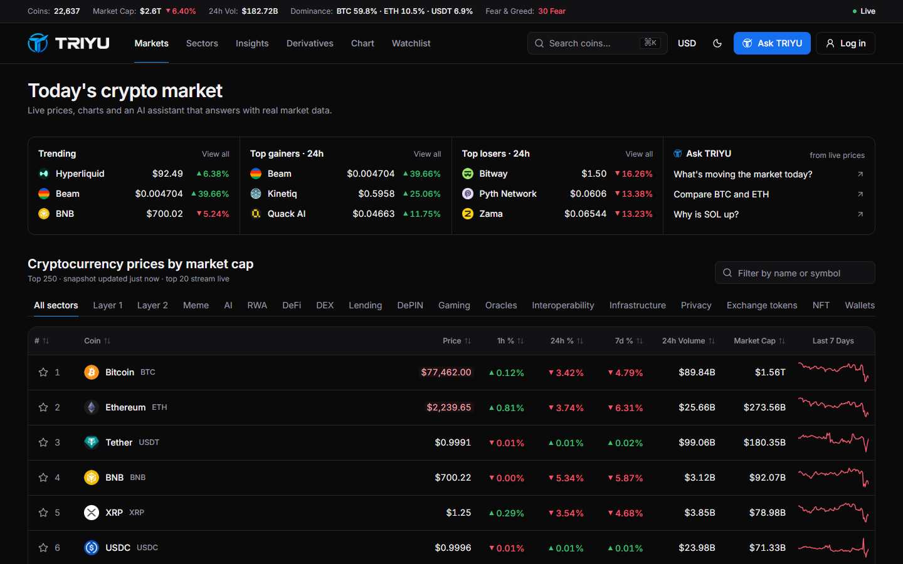
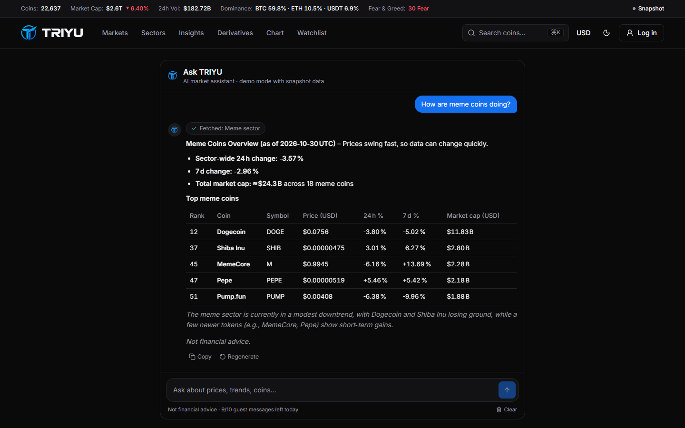
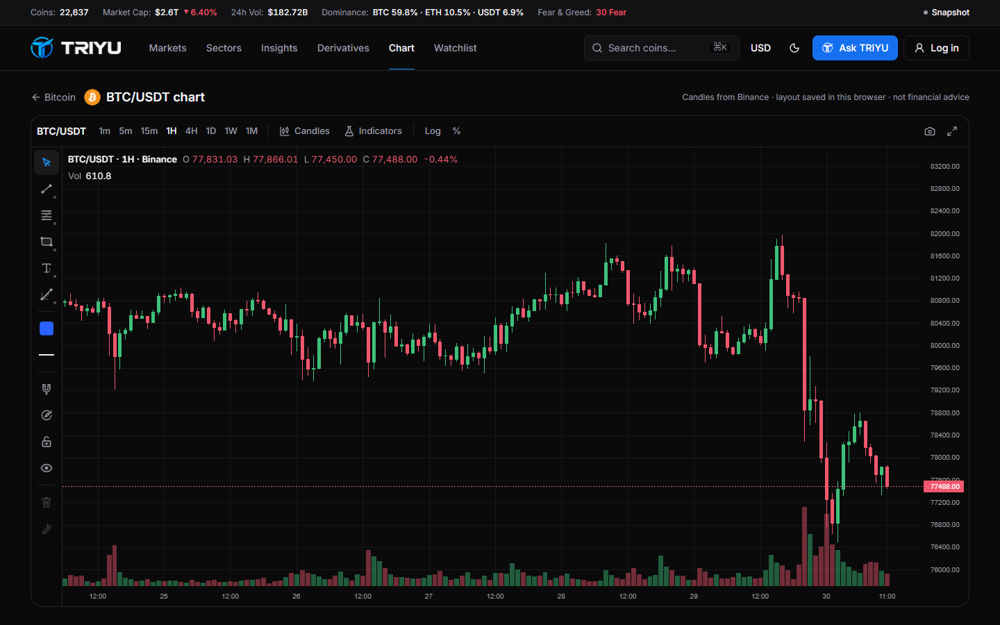
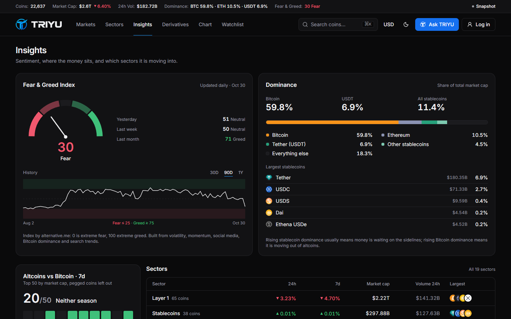
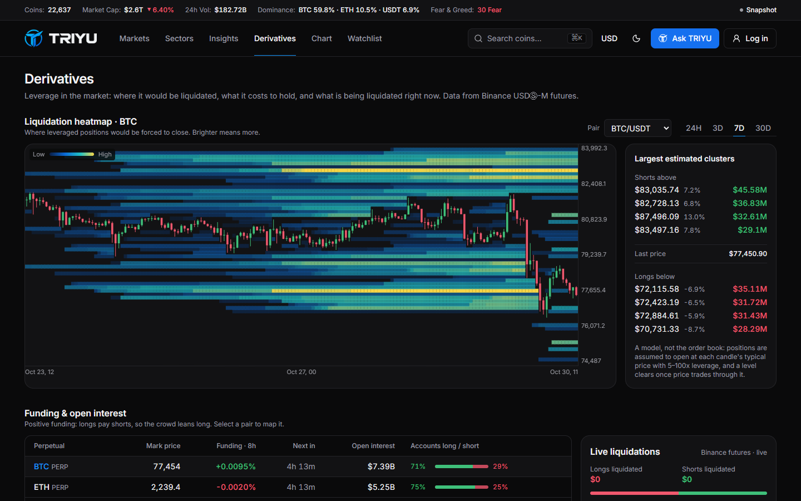

# TRIYUAI

[](https://github.com/Rtmagent7/triyuai/actions/workflows/ci.yml) [](https://github.com/Rtmagent7/triyuai/releases/latest) [](https://github.com/Rtmagent7/triyuai/actions/workflows/uptime.yml)

**Real-time crypto dashboard with an AI market assistant.** Portfolio project. The full spec is in [`PRDProject1.md`](./PRDProject1.md).

**[Live demo](https://triyuai.vercel.app)** · **[Demo video (1:46)](https://github.com/Rtmagent7/triyuai/releases/download/v1.0.0/triyu-demo.mp4)** · **[API docs (Swagger)](https://triyuai-api.vercel.app/docs)** · one-click demo account on [/login](https://triyuai.vercel.app/login), no sign-up needed



| Ask TRIYU answering from live data             | Technical-analysis chart                         |
| ---------------------------------------------- | ------------------------------------------------ |
|          |              |
| **Insights: Fear & Greed, dominance, sectors** | **Derivatives: liquidation heatmap, funding**    |
|      |  |

> Status: **live, full stack.** The Next.js app on Vercel proxies `/api/v1` to the Express API (a second Vercel project) backed by Neon Postgres. Market data comes from CoinGecko, live prices and futures data from Binance, and Ask TRIYU runs on Groq with Gemini as fallback.

## Features

| Feature                                                                                                                             | Where                                     |
| ----------------------------------------------------------------------------------------------------------------------------------- | ----------------------------------------- |
| Global stats bar (auto-refresh 60 s)                                                                                                | every page                                |
| Top-250 market table: sort, filter, sparklines, `?page=1..3`, sticky header/coin column                                             | `/`                                       |
| Live prices for the top 20 (Binance WebSocket, flash on change, backoff + polling fallback)                                         | `/`, coin pages, watchlist                |
| Highlights: trending, gainers, losers, highest volume                                                                               | `/`, `/highlights`                        |
| ⌘K / Ctrl+K command palette (debounced search, trending, recent searches)                                                           | every page                                |
| Coin detail: header, 24h range, line/candlestick chart (24H–MAX), stats, converter, about, OG image                                 | `/coins/[id]`                             |
| **Ask TRIYU** chatbot: streaming, tool chips, markdown tables, Stop/Copy/Regenerate, refuses buy/sell advice, 10 guest messages/day | floating panel + `/ask`                   |
| Converter synced to the URL                                                                                                         | `/converter?from=bitcoin&to=idr&amount=1` |
| Watchlist: on the device for guests, synced to the account when signed in (local list merged on first login, optimistic updates)    | `/watchlist`                              |
| Accounts: register, login, one-click demo account, httpOnly cookie sessions                                                         | `/login`, `/register`                     |
| Technical-analysis chart: Binance candles, 1m–1M, indicators with full settings, 27 drawing tools, saved layouts                    | `/chart/[id]`, coin pages                 |
| Sectors: all top-250 coins filed under their real CoinGecko categories (Layer 1, Meme, AI, RWA, DeFi…), sector performance          | `/categories`, `/categories/[id]`         |
| Insights: Crypto Fear & Greed Index with history, BTC/ETH/USDT/stablecoin dominance, altcoins vs Bitcoin                            | `/insights`, stats bar                    |
| Derivatives: estimated liquidation heatmap, live Binance liquidations, funding rates, open interest, long/short ratio               | `/derivatives`                            |
| Dark/light/system theme, USD/IDR/EUR                                                                                                | navbar                                    |
| 404, error boundaries, disclaimer, case study                                                                                       | `/about`, `/disclaimer`                   |

## Getting started

Requirements: Node 22+ and pnpm 10+. No database, Redis or API keys are needed to run it locally.

**Prototype mode** (frontend only, mock API):

```bash
pnpm install
cp apps/web/.env.example apps/web/.env.local
pnpm --filter @triyuai/web dev     # http://localhost:3000
```

**Full stack** (Express API + frontend):

```bash
cp apps/api/.env.example apps/api/.env      # every service is optional, see below
pnpm --filter @triyuai/api dev              # http://localhost:4000, Swagger UI at /docs

# apps/web/.env.local
NEXT_PUBLIC_API_MOCKING=disabled
API_ORIGIN=http://localhost:4000
```

Without credentials, the API falls back to local stand-ins:

| Service                   | With credentials              | Without (local development)                              |
| ------------------------- | ----------------------------- | -------------------------------------------------------- |
| Postgres                  | Neon (`DATABASE_URL`)         | Embedded PGlite in `apps/api/.pglite`, migrated on start |
| Cache, rate limit, quotas | Upstash Redis                 | In-memory (single process)                               |
| Market data               | CoinGecko Demo key            | Keyless public API (low, shared rate limit)              |
| Ask TRIYU                 | Groq, then Gemini as fallback | `/ai/chat` returns 503                                   |

Other scripts:

```bash
pnpm build          # production build (all workspaces)
pnpm typecheck
pnpm lint
pnpm format
pnpm fixtures       # refresh the CoinGecko snapshot (takes ~10–20 min on the keyless API)
```

## Project structure

```
apps/api/                 Express 5 API (Vercel Function in Phase 4)
  src/services/           CoinGecko client, cached market service, auth, watchlist
  src/ai/chat.ts          Ask TRIYU: AI SDK tools + Groq → Gemini fallback, SSE events
  src/routes/             /api/v1 routers; OpenAPI document + Swagger UI at /docs
  prisma/                 schema + SQL migrations (User, RefreshToken, WatchlistItem, MarketSnapshot)
  test/                   Supertest contract/integration tests on PGlite + optional real Postgres
apps/web/                 Next.js 15 (App Router), React 19, Tailwind CSS v4
  src/app/                routes (SSR/ISR/SSG per PRD §8)
  src/components/         UI by domain: market, coin, chat, search, layout, converter, ui
  src/hooks/              TanStack Query hooks, live prices, currency formatting
  src/stores/             Zustand: preferences, watchlist, chat, live prices, recent searches
  src/lib/api/            browser client (→ MSW), server adapter, query keys
  src/mocks/              MSW handlers, fixture-backed data layer, mock chat engine, fixtures/
packages/shared/          Zod schemas = the API contract; CoinGecko mappers and chart helpers
scripts/fetch-fixtures.ts snapshot generator (CoinGecko public API, same mappers as the API)
```

## Engineering decisions

- **Contract first, MSW second.** `packages/shared` defines every `/api/v1` request and response with Zod. MSW, the Express API and the Swagger docs all use the same schemas, and the API tests check every response against them. Switching the frontend to the real API only needs `NEXT_PUBLIC_API_MOCKING=disabled` and `API_ORIGIN`.
- **Same-origin API.** The browser calls `/api/v1` on the web origin and Next.js rewrites it to the API. Auth cookies stay first-party (`SameSite=Lax`, `httpOnly`), and no CORS preflight is needed. A readable `triyu_session` hint cookie (no secret) lets guests skip `/auth/me` entirely, so they never trigger a 401.
- **Stay inside 10,000 CoinGecko calls a month.** Every response is cached in Redis with a per-endpoint TTL (5 min to 6 h), and concurrent misses share one upstream call. Above 80% of the monthly budget all TTLs triple. Prices are fetched in USD only, and IDR/EUR are converted with hourly rates. Coin pages render on demand (ISR) instead of 100 at build time, and list links do not prefetch coin pages.
- **Degrade, don't fail.** The last good response for each key is saved in Postgres. When CoinGecko rate-limits, the API serves that snapshot with `stale: true` and the UI shows a "Data delayed" badge. A coin page without a snapshot falls back to its row from the top-250 list.
- **Sessions.** argon2id password hashes. A 15-minute JWT access cookie plus a 7-day opaque refresh token, stored hashed and rotated on every use. Reusing an old refresh token revokes all of the user's sessions. Login is throttled per IP and email, and unknown emails take the same time as wrong passwords.
- **AI that cannot make up prices.** Ask TRIYU only gets numbers through seven tools (`getMarketOverview`, `getCoinDetails`, `getTopMovers`, `searchCoin`, `compareCoins`, `getSentiment`, `getSectorPerformance`) backed by the cached market service. Groq is tried first; if it fails before any output is streamed, Gemini takes over. Quotas are 10 messages a day per hashed IP for guests and 30 for signed-in users, enforced in Redis.
- **MSW starts lazily.** The service worker only starts on the first client-side API call, so server-rendered HTML is never blocked by it.
- **Real snapshot, honest gaps.** Top-250 market data, global stats, trending and FX rates come from a real CoinGecko snapshot, and the top 20 coins also have full details and one year of price history. Charts for other coins are simulated from their real 7-day sparkline and labelled as such in the UI. The keyless API caps history at 365 days, so MAX shows one year.
- **Binance host.** Live prices use `data-stream.binance.vision`, Binance's market-data-only endpoint, with `stream.binance.com` as the fallback. `binance.com` is blocked by many Indonesian ISPs; the `binance.vision` host is not.
- **Ticks are batched.** WebSocket messages are flushed into a Zustand store at most every 500 ms. Only the affected `PriceCell`s re-render and flash, and `tabular-nums` keeps digits from shifting.
- **Logos load from the CDN, not through `next/image` optimisation.** The `small` CoinGecko variants are tiny already, and proxying 250+ images would use up the Vercel Hobby image quota.
- **Liquidation heatmap is a model, and says so.** Positions opened in each candle (from rising Binance open interest) are spread over 5–100x leverage; a level clears once price trades through it. Where `fapi.binance.com` is blocked, spot candles from `binance.vision` stand in, with volume as the proxy.
- **Sectors are data, not guesses.** `pnpm sectors` pulls each sector's members from CoinGecko's category endpoints; a short, reviewed override list (`scripts/sector-overrides.ts`) fixes the few coins whose tags would give them the wrong primary sector.
- **One API, one Vercel Function.** esbuild bundles the Express app and the workspace's TypeScript packages into `dist/server.mjs`; `api/index.mjs` re-exports it. Production builds run `prisma migrate deploy` over Neon's direct connection, and the API project only deploys from `main`.
- **The chart is lazy-loaded.** Lightweight Charts loads after first paint, which keeps the coin page at about 181 kB of first-load JS (budget: 200 kB).

## Testing

| Layer             | Tooling                                      | What it covers                                                                                                                                                                                                                                                                                                                                                                                                                                                    |
| ----------------- | -------------------------------------------- | ----------------------------------------------------------------------------------------------------------------------------------------------------------------------------------------------------------------------------------------------------------------------------------------------------------------------------------------------------------------------------------------------------------------------------------------------------------------- |
| Unit & component  | Vitest, React Testing Library, MSW (Node)    | Formatters, sanitizer, Binance client (fake WebSocket), mock data layer, chat engine, Zustand stores (incl. SSE streaming, stop, regenerate, quota), hooks, and every UI component. Coverage gate is ≥ 80% (currently ~93% of lines with Vitest 5's V8 coverage).                                                                                                                                                                                                 |
| End-to-end        | Playwright                                   | The five flows from the PRD's 60-second demo script, plus pagination, converter URL state and 404. The Binance socket is replaced with `routeWebSocket` so live-price flashes are deterministic.                                                                                                                                                                                                                                                                  |
| Accessibility     | axe-core in Playwright                       | 8 pages × dark/light against WCAG 2.2 AA (fails on serious/critical), the chat dialog's keyboard flow, and mobile overflow on every page.                                                                                                                                                                                                                                                                                                                         |
| API               | Vitest, Supertest, PGlite, Postgres 17 in CI | Every endpoint checked against the shared Zod contract. Also covers caching and request de-duplication, snapshot fallback, the quota guard, the auth flow (cookies, refresh rotation and reuse detection, throttling, demo reset), watchlist sync, rate limits, and the AI stream with a mock model (tools, context, Groq→Gemini fallback, quotas). In CI the account flow also runs against real Postgres after `prisma migrate deploy`. Coverage ~94% of lines. |
| Performance & SEO | Lighthouse CI (mobile)                       | Home and coin page. Accessibility, Best Practices and SEO must reach ≥ 0.95 and CLS < 0.1; Performance ≥ 0.9 is a warning because shared runners are noisy.                                                                                                                                                                                                                                                                                                       |

```bash
pnpm test                         # web + API (unit, component, contract, integration)
pnpm --filter @triyuai/web test:coverage
pnpm build && pnpm test:e2e       # E2E against the production build
# locally, reuse installed Chrome instead of downloading Chromium:
E2E_CHANNEL=chrome pnpm test:e2e
```

An uptime workflow (`.github/workflows/uptime.yml`) checks the site, the API and the proxied market data every 15 minutes, opens an `uptime` issue when a check still fails on a retry 20 s later, and closes it on recovery.

CI (`.github/workflows/ci.yml`) runs four parallel jobs on every PR and on every push to `main`: quality, API tests against a Postgres service, E2E + accessibility, and Lighthouse. Dependabot opens weekly update PRs.

**Bugs the tests caught:**

- Light-mode text contrast was below WCAG AA, so the light tokens are darker than the PRD draft.
- The ⌘K "Clear" button sat inside an `aria-hidden` heading.
- Converter selects announced the coin logo's alt text as part of their name.
- `/highlights` and `/converter` overflowed horizontally on phones.
- The mobile menu stayed open after navigating.
- Compact currency formatting differed between Node 22 and browsers, which caused a hydration error.
- Coin descriptions lost links whose `href` contained `'`.
- (Phase 3) List links prefetched every visible coin page, so each homepage visit triggered dozens of CoinGecko calls and hit the rate limit.
- (Phase 3) Starring a coin before `/auth/me` returned saved it to the device instead of the account.
- (Phase 3) One malformed logo URL in CoinGecko data made their CDN hang, which stalled `networkidle` in E2E runs. Logos are now stubbed in E2E.

## Known limitations

- Upstash Redis isn't connected yet, so cache, rate limits and chat quotas live in each function instance's memory.
- Free tiers: CoinGecko Demo (10,000 calls a month) and Groq/Gemini rate limits. When CoinGecko throttles, the API serves its saved snapshot and the UI says "Data delayed".
- Binance futures (`fapi.binance.com`) is blocked on some networks; funding rates and the live liquidation feed then show a notice.
- Prototype mode (`NEXT_PUBLIC_API_MOCKING=enabled`, used by previews and E2E) still runs the rule-based Ask TRIYU and simulated accounts.
- Backend tests use PGlite (Postgres compiled to WASM) locally, plus a real Postgres service in CI, instead of Testcontainers.

## Attribution

Data provided by [CoinGecko](https://www.coingecko.com/). Live prices from the Binance public WebSocket. Not financial advice.
