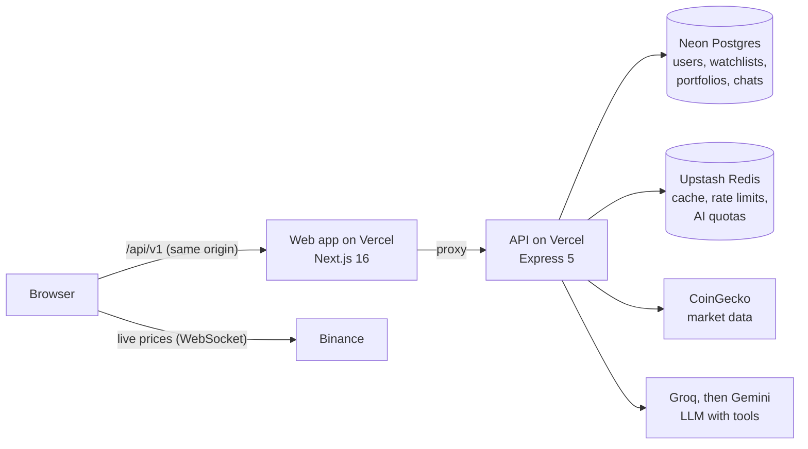

# TRIYUAI

[](https://github.com/Rtmagent7/triyuai/actions/workflows/ci.yml) [](https://github.com/Rtmagent7/triyuai/releases/latest) [](https://github.com/Rtmagent7/triyuai/actions/workflows/uptime.yml)

TRIYUAI is a crypto market dashboard with an AI assistant built in. Prices update live, and you can
ask the assistant about the market in plain English.

[Live site](https://triyuai.vercel.app) · [Demo video (1:46)](https://github.com/Rtmagent7/triyuai/releases/download/v1.0.0/triyu-demo.mp4) · [API docs](https://triyuai-api.vercel.app/docs)


## About the project

I built TRIYUAI on my own as a portfolio project. I wrote the spec first, then the frontend, the API,
the database, the AI part, the tests and the deployment pipeline.

The site follows the top 250 coins. The top 20 tick in real time from Binance. The assistant,
Ask TRIYU, can answer things like "How has Solana done this week compared to Ethereum?". Every number
it gives you comes from the same data the site shows, because the model has to look prices up through
the API instead of answering from what it remembers. It also refuses buy or sell advice.

Everything runs on free plans: Vercel, Neon, Upstash, CoinGecko, Groq and Gemini. That decided a lot
of the engineering. Most of the backend work went into caching and fallbacks so the site keeps working
when a free quota runs out.

## Trying it out

You don't need to sign up for any of this.

1. Open [triyuai.vercel.app](https://triyuai.vercel.app) and watch the top of the table. Prices flash green or red as trades come in.
2. Press <kbd>Ctrl</kbd>+<kbd>K</kbd> (<kbd>⌘</kbd>+<kbd>K</kbd> on a Mac), search for `solana` and open its page. Try a few chart ranges and switch to candles.
3. Click **Ask TRIYU about Solana**. The reply streams in, and small chips above it show which data the assistant fetched.
4. Go to [/login](https://triyuai.vercel.app/login) and press **Try the demo account**. Star a few coins, then add a trade on the Portfolio page. Both stay on the account.
5. Dark mode and the currency switch (USD, IDR, EUR) are in the navbar.

## Features

### Market data

- A table of the top 250 coins you can sort and filter, with 7-day sparklines. On a phone the header and coin column stay in place while you scroll.
- A page for each coin with a price chart (line or candles, from 24 hours up to the full history), key stats, a converter and a generated preview image for when the link is shared.
- A separate charting page for technical analysis. It uses Binance candles from 1 minute to 1 month and has indicators, 27 drawing tools, and layouts that are saved for next time.
- Other pages: Fear & Greed, market dominance, sectors, coin comparison, exchange rankings, news tagged by coin, and derivatives data like funding rates and an estimated liquidation heatmap.

### Accounts

- Sign up with email and password or Google, or use the shared demo account.
- The watchlist works without an account. When you sign in, the coins you starred as a guest move into your account.
- The portfolio tracker records buys and sells. It works out average cost, realised and unrealised profit, and allocation at live prices.

### Ask TRIYU

- The model can only get numbers through eight tools: market overview, coin details, top movers, search, comparison, sentiment, sectors and news.
- Replies stream in over Server-Sent Events. You can stop a reply, copy it or regenerate it.
- Groq is the main model, and Gemini takes over if Groq fails. Signed-in users keep their past conversations. Guests get 10 messages a day and accounts get 30, which keeps it inside the free tiers.

## Screenshots

| Ask TRIYU answering from live data         | Technical-analysis chart                         |
| ------------------------------------------ | ------------------------------------------------ |
|      |              |
| **Fear & Greed, dominance and sectors**    | **Liquidation heatmap and funding rates**        |
|  |  |
| **Coin page**                              | **Phone layout**                                 |
|     |            |

## Architecture



The browser never calls the API's domain directly. It sends requests to `/api/v1` on the web app, and
Next.js passes them on to the API. That keeps the login cookies first-party, and I didn't need any
CORS setup. Live prices are the one exception: they come straight from Binance's public WebSocket.

| Area     | What I used                                                                                       |
| -------- | ------------------------------------------------------------------------------------------------- |
| Frontend | Next.js 16 (App Router), React 19, TypeScript, Tailwind CSS v4, TanStack Query and Table, Zustand |
| Backend  | Node 22, Express 5, Prisma 7, PostgreSQL on Neon, Redis on Upstash, Zod, OpenAPI with Swagger UI  |
| AI       | Vercel AI SDK, Groq, Google Gemini, tool calling, SSE streaming                                   |
| Testing  | Vitest, React Testing Library, MSW, Supertest, Playwright, axe-core, Lighthouse CI                |
| Ops      | Two Vercel projects, GitHub Actions, Sentry, a scheduled uptime check, Dependabot                 |
| Repo     | pnpm workspaces and Turborepo                                                                     |

## Design notes

These are the choices I'd talk about in an interview. Each one has a longer write-up in
[`docs/adr`](docs/adr/README.md).

I wrote the API contract before any backend code. Each request and response is a Zod schema in
`packages/shared`, and the frontend, the API, the mock server and the Swagger page all use those
schemas. Because of that, the frontend could go live on a mock API weeks before the backend was
ready. Switching it over later took two environment variables.

CoinGecko's free plan gives 10,000 calls a month, which a busy dashboard would use up in a day. Every
endpoint has its own cache time in Redis. When several requests miss the cache at once, they share one
upstream call. After 80% of the monthly budget is used, cache times triple. If CoinGecko still fails,
the API serves the last good copy from Postgres, and the UI marks it "Data delayed".

The AI assistant can't make up prices because it never sees a price unless a tool returned it. If Groq
fails before it has sent any text, the same request goes to Gemini, and the user doesn't notice.

The whole Express API is bundled with esbuild into one file and runs as a single Vercel Function.
Database migrations run during the production build, and only the `main` branch deploys.

I wrote Google sign-in without an auth library: the authorization code flow with PKCE, with the ID
token checked against Google's public keys. It fits into the cookie sessions I already had. It's
around 150 lines, tested against a fake Google.

Sentry only loads in the browser once the page has finished loading. It only receives unexpected
errors, and it's set up to never send cookies or request bodies.

## Testing

| What                    | Numbers                                                                        |
| ----------------------- | ------------------------------------------------------------------------------ |
| Web (unit, component)   | 278 tests, about 93% line coverage (CI fails below 80%)                        |
| API                     | 88 tests, about 94% line coverage, every response checked against the contract |
| End-to-end              | 75 Playwright tests covering the main user flows                               |
| Accessibility           | axe-core on 8 pages in both themes (WCAG 2.2 AA), plus keyboard checks         |
| Lighthouse (mobile, CI) | Home page 91 performance, 100 accessibility, 100 best practices, 100 SEO       |
|                         | Coin page 90, 100, 96, 100                                                     |

Every pull request runs four CI jobs in parallel. One does lint, type checks and unit tests. One runs
the API tests against a real Postgres. One does end-to-end and accessibility tests, and the last runs
Lighthouse. Separately, a scheduled job checks the live site every 15 minutes and opens an issue if
it stays down.

Some real bugs the tests caught:

- Text in light mode failed WCAG contrast, so I darkened the colour tokens.
- Node and browsers formatted compact numbers differently, which broke hydration.
- Links on the homepage prefetched every visible coin page, which cost dozens of API calls per visit.
- Starring a coin before the session finished loading saved it on the device instead of the account.

## Running it locally

You need Node 22+ and pnpm 10+. There's no database, Redis or API key to set up.

```bash
pnpm install
cp apps/web/.env.example apps/web/.env.local
pnpm --filter @triyuai/web dev        # http://localhost:3000, on the mock API
```

To run against the real API instead:

```bash
cp apps/api/.env.example apps/api/.env  # every service in it is optional
pnpm --filter @triyuai/api dev          # http://localhost:4000, Swagger at /docs

# then set these in apps/web/.env.local
NEXT_PUBLIC_API_MOCKING=disabled
API_ORIGIN=http://localhost:4000
```

If a credential is missing, the API uses a local stand-in: an embedded Postgres (PGlite), an
in-memory cache and CoinGecko's keyless API. The assistant is the exception. It needs a Groq or
Gemini key.

```bash
pnpm test                          # web and API tests
pnpm build && pnpm test:e2e        # end-to-end against a production build
pnpm typecheck && pnpm lint
```

<details>
<summary><strong>Project structure</strong></summary>

```
apps/web/              Next.js app
  src/app/             pages and routes
  src/components/      UI, grouped by area (market, coin, chat, portfolio, news, layout, ui)
  src/hooks/           data fetching, live prices, sessions
  src/stores/          client state (preferences, watchlist, chat, live prices)
  src/mocks/           the mock API, fixtures and scripted chat used by previews and E2E
apps/api/              Express API
  src/routes/          /api/v1 endpoints, Swagger at /docs
  src/services/        market data and caching, auth, Google sign-in, watchlist, portfolio, news
  src/ai/              Ask TRIYU's tools, model fallback and streaming
  prisma/              schema and SQL migrations
  test/                API, contract and integration tests
packages/shared/       the API contract (Zod), used by both apps
docs/                  decision records, deploy notes, screenshots
```

</details>

## Known limitations

- The free plans set the limits. When CoinGecko throttles requests, the site falls back to saved data and labels it "Data delayed". Groq and Gemini have their own rate limits.
- Some networks block Binance's futures API. When that happens, the derivatives page tells you why it's empty.
- Pull-request previews run on the mock API, so the assistant there is a scripted demo, not the real model.

## Credits

Market data comes from [CoinGecko](https://www.coingecko.com/), and live prices from Binance's
public WebSocket. The original spec is in [`PRDProject1.md`](./PRDProject1.md). None of this is
financial advice.
